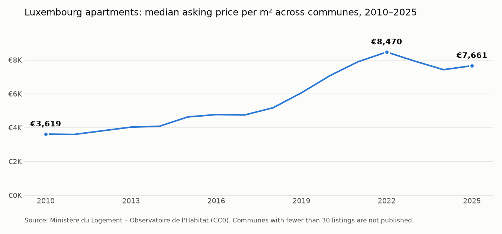

# Analyst Copilot

**An AI copilot for data analysts.** It profiles a dataset, checks its quality, validates it, runs the right analyses
and drafts the report in English, French and Arabic. **The analyst reviews and approves every step.**
Code computes every number; the AI only interprets, so a figure in the report is never invented.



*Built from a real run on Luxembourg's official housing price data. Every number in the chart comes from the copilot's
own tool results.* Full output: [**sample report**](docs/sample_report.md) · Cost of that run: **$0.15**.

## Why a copilot, not an autopilot

Analysts spend much of their time on the parts of the job that come before the insight: understanding a new
dataset, finding what's wrong with it, checking it can be trusted. The copilot does that groundwork fast, and the
analyst stays in charge of every decision:

- **Pause after each step** (`--review`): accept the result, edit the step's prompt and redo it, or stop.
- **Every step is saved** as JSON, with the facts, the AI's judgement, the tokens used and the request ids.
- **Nothing is hidden in the model.** Numbers come from pandas; validation rules run from a fixed whitelist; the AI
  never executes code.

## How it works

```
dataset.csv
   │
   ▼
[1 Profile] ─► [2 Quality] ─► [3 Integrity] ─► [4 Statistics] ─► [5 Report]
 what is it?   what's wrong?   do the rules     which analyses    for a manager, in
 + proposes                    hold?            matter?           English, French, Arabic
   validation rules ──────────────►┘            (tool use)
          ▲             ▲              ▲               ▲              ▲
          └──────── the analyst reviews and approves each step ───────┘
```

| Step | Code computes (pandas) | The AI (Claude) judges |
|---|---|---|
| 1 Profile | types, distinct values, numeric share, examples | what each column means; **proposes validation rules** as data, from a fixed list of rule types |
| 2 Quality | missing values, placeholders, duplicates, IQR outliers, similar spellings, rows per year | which findings are real problems, their severity, the fix |
| 3 Integrity | runs every rule (from step 1 and the analyst's own in `pipeline.yaml`) | what each failure means; is the data safe to analyse, and on which conditions |
| 4 Statistics | a toolbox: `describe`, `trend`, `top_n`, `growth`, `correlation`, `coverage` | **chooses which analyses to run** (tool use, capped at 8 calls), then writes findings citing tool results |
| 5 Report | n/a | headline, findings, caveats, next steps, and a summary in each requested language |

Structured outputs make every step return JSON matching a schema, and the statistics tools use strict schemas, so a
step can't hand back malformed results.

## Real example: Luxembourg housing prices

Data: apartment asking prices by commune, 2010–2025, from the Ministère du Logement – Observatoire de l'Habitat
([data.public.lu](https://data.public.lu/fr/datasets/prix-annonces-des-logements-par-commune/), CC0).
The data was used as published, mess included. The copilot found:

- **37% of prices are masked** (620 of 1,675 rows show `*`): the publisher hides communes with fewer than 30 listings.
  The copilot treats them as missing, never as zero.
- **The commune list shrinks from 116 to 100** as communes merged, so it compares like with like (54 communes with
  data in both 2010 and 2025) before reporting growth.
- **Headline:** the median price per m² rose from **€3,619** (2010) to a **€8,470** peak (2022), then **€7,661** (2025);
  Bertrange grew fastest (+163%).

## Run it

Requires [uv](https://docs.astral.sh/uv/) and a Claude API key ([console.anthropic.com](https://console.anthropic.com)).

```bash
echo 'ANTHROPIC_API_KEY=...' > .env     # stays on your machine (gitignored)
uv sync
uv run adp extract                      # Excel workbook -> data/housing_apartments_2010_2025.csv
uv run adp run --dry-run                # every fact, no AI calls (free)
uv run adp run --review                 # full run, pausing after each step
uv run adp run --step quality           # redo one step after editing prompts/2_quality.md
uv run adp show integrity               # print a step's result
```

Each step's model and effort are set in `pipeline.yaml`: Claude Haiku 5.5 for the routine steps, Claude Opus 5.5 for
the analysis and the report.

## Project layout

```
pipeline.yaml        steps, models, effort, the analyst's own rules
prompts/             one editable prompt per step
src/adp/facts.py     deterministic profiling, quality checks, rule engine
src/adp/tools.py     the statistics toolbox (strict JSON schemas)
src/adp/llm.py       Claude calls: structured JSON, the tool-use loop, errors and refusals
src/adp/steps.py     the five steps
src/adp/pipeline.py  orchestration, saved results, review mode, report
scripts/make_chart.py   the chart above, from a run's saved results
tests/               offline tests (no API calls): uv run --group dev pytest
```

---
Built by Mariam Janati Idrissi · Business Intelligence Engineer, Luxembourg ·
[LinkedIn](https://www.linkedin.com/in/Mariam-Janati-Idrissi)
